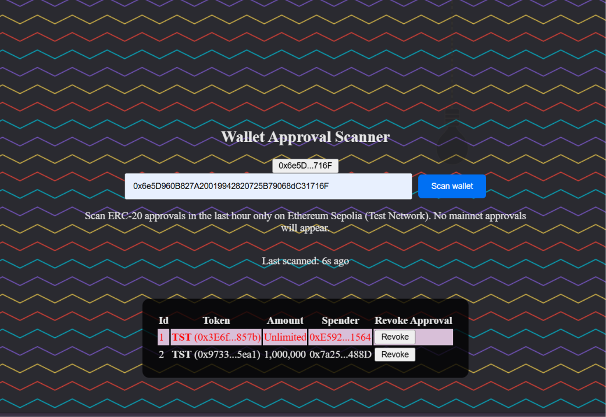

# Wallet Approval Scanner

Finds the ERC-20 token approvals an Ethereum wallet has given, flags the unlimited
ones, and lets the wallet owner revoke them on-chain.

Built with React, Express and ethers.js v6. Runs against **Ethereum Sepolia** (testnet).



---

## The problem

Every time you use a DEX, a bridge or a lending app, you sign an `approve` transaction
that lets that contract move your tokens. Many dapps ask for `MaxUint256`, an unlimited
allowance, so you never have to approve again.

That allowance does not expire. It stays live after you stop using the dapp, and if the
contract is later exploited, the attacker can call `transferFrom` and drain the approved
token without you signing anything new.

This tool shows you what you have left open, and closes it.

---

## What it does

- Scans a wallet's `Approval` events from roughly the last hour and reads each approval's
  **live** allowance from the token contract, rather than trusting the amount in the
  original event.
- Flags unlimited approvals and highlights those rows.
- Formats amounts with each token's own `decimals`, falling back to the raw integer when a
  token doesn't expose them.
- Revokes an approval by sending `approve(spender, 0)` from the connected wallet, then
  re-reads the allowance on-chain and only reports success if it is actually zero.
- Links each revoke transaction to Sepolia Etherscan.
During testing, a wallet’s approval screen showed ‘Unlimited’ while the transaction it signed approved exactly the wallet’s balance; the scanner showed the real amount.

---

## How it works

The parts that were not obvious while building it:

**Log scanning is chunked.** `eth_getLogs` is filtered on
`topics[0] = keccak256("Approval(address,address,uint256)")` and
`topics[1] =` the owner address, left-padded to 32 bytes. Providers cap the block range a
single `eth_getLogs` call may cover, so the backend walks a 300-block lookback in 10-block
chunks instead of asking for the whole range at once. 300 blocks at ~12 seconds each is
roughly one hour of history, a deliberate limit (see Known limits).

**ERC-721 shares the event signature.** `Approval(address,address,uint256)` is the same for
ERC-20 and ERC-721, so NFT approvals match the same `topics[0]`. They are told apart by
shape: ERC-721 also indexes the token ID, giving **four** topics, while ERC-20 has three.
Four-topic logs are dropped in `backend/pairs.js`.

**Token/spender pairs are deduplicated before any contract call.** Approving the same
spender on the same token five times produces five logs but needs one `allowance()` read.
Pairs go into a `Set`, and `ethers.Contract` instances are cached in a `Map` keyed by
token address, so each token's contract object is created once however many spenders it
has.

**"Unlimited" is checked against two values.** The usual one is `MaxUint256`
(2²⁵⁶ − 1). Some tokens, such as UNI and COMP, store allowances as `uint96`; approving
them for `MaxUint256` stores 2⁹⁶ − 1 instead. So `(1n << 96n) - 1n` also counts as
unlimited.

**Missing token metadata doesn't kill the scan.** `symbol()` and `decimals()` are optional
in ERC-20, and some deployed tokens omit them or return malformed data. Both calls are
wrapped so that a `CALL_EXCEPTION` or `BAD_DATA` error returns `null` for that field and
the scan continues: the row shows the token's address without a symbol, or the raw amount
marked "decimals unknown". Any other error, such as a rate limit, is rethrown.
`allowance()` itself is not wrapped (see Known limits).

**The RPC key never reaches the browser.** The React app talks only to the Express
backend, and only the backend holds the Alchemy URL. Even so, the key leaked once during
testing: when the RPC returned a server error, ethers v6 included the full request URL,
key and all, in `error.message`, and the original 500 handler sent that message to the
client. The key was rotated, and error responses now return fixed strings, with the real
error logged on the server only.

**Rate limits answer properly.** A 429 from the provider comes back to the client as a 429
with a `Retry-After: 10` header and a readable message, not a generic 500.

**Revoking verifies rather than assumes.** Before anything is sent, the app checks the
wallet live at click time: a wallet is installed, it is connected, it is on Sepolia, and it
is the same address that was scanned. After `approve(spender, 0)` is sent, the app polls
for the receipt every 3 seconds, checks `receipt.status === 1`, then does a fresh
`allowance()` read. The row is only marked revoked if that read returns `0`. It polls
`getTransactionReceipt` itself instead of using ethers' `tx.wait()`, which in testing
sometimes had not resolved minutes after Etherscan already showed the transaction as
mined. An in-flight `Set` keyed by owner + token + spender stops a double click from
sending the same revoke twice.

If the transaction reverts, or the allowance is not zero afterwards, the row shows
**Failed** and can be retried. If no receipt arrives within about three minutes, or
anything fails after the transaction was sent, the row shows **Unconfirmed** with its
Etherscan link and the button stays locked: the transaction may still be mined, so a
retry would risk sending a second one. Scanning again clears the state. A revoke that went
through drops off the list, and one that didn't shows **Revoke** again.

---

## Stack

| | |
|---|---|
| Frontend | React 19, Vite 8 |
| Backend | Node.js, Express 5 |
| Chain | ethers.js v6, Alchemy JSON-RPC, Ethereum Sepolia |
| Contract reads | `eth_getLogs`, `allowance()`, `decimals()`, `symbol()` |
| Writes | `approve(spender, 0)` via an injected browser wallet |

---

## Running it locally

**You need:** Node 20.19+ (or 22.13+), a Sepolia RPC URL from Alchemy or another
provider, and a browser wallet such as MetaMask with a little Sepolia ETH for gas.

### Backend

```bash
cd backend
npm install
```

Create `backend/.env`:

```
RPC_URL=https://eth-sepolia.g.alchemy.com/v2/YOUR_KEY
PORT=3000
```

`.env` is gitignored. Do not commit it.

```bash
npm start      # or: npm run dev  (requires nodemon)
```

The backend listens on `http://localhost:3000`.

### Frontend

```bash
cd build1
npm install
npm run dev
```

Vite serves on `http://localhost:5173`, which is the only origin the backend's CORS
config allows.

### Using it

1. Paste a Sepolia address. Until it's a valid address, the Scan button stays faded and a hint says why; once it's valid, the bulb lights up. Press **Scan wallet**. You don't need to connect a wallet to scan.
2. Approvals from the last ~hour appear in the table. Unlimited ones are highlighted.
3. To revoke, press **Connect wallet**. The connected wallet must be the one you scanned,
   and it must be on Sepolia. Otherwise the app tells you what to change instead of
   sending a transaction.
4. Press **Revoke** on a row and confirm in your wallet. The button shows the progress,
   and an Etherscan link appears once the transaction is sent.

### API

| Route | Returns |
|---|---|
| `GET /approvals/:address` | `{ success, data: [...] }`, a live scan of that address |
| `GET /approvals` | static sample data from `backend/list.js`; the frontend doesn't use it |

---

## Known limits

These are real constraints, not bugs:

- **Sepolia only.** The revoke check is hardcoded to chain ID `11155111`, and the backend
  scans whichever chain its `RPC_URL` points to.
- **About one hour of history.** The 300-block lookback keeps the scan inside free-tier
  RPC limits. A wallet's older approvals are not found. Covering full history needs an
  indexer or a paid log API, which is the main thing standing between this and a tool
  anyone could use on mainnet.
- **ERC-20 only.** NFT approvals, both single-token `approve` and `setApprovalForAll`, are
  not shown. An empty table does not mean the wallet has no NFT approvals.
- **One bad token fails the whole scan.** If a token's `allowance()` call reverts, the
  scan returns an error instead of skipping that token.
- **No pagination or caching.** Every scan re-queries from scratch.
- **Only exact max values count as unlimited.** An approval that isn't exactly one of the two max values shows as a number and isn't highlighted, however large it is.

---

## Roadmap

- [ ] Transaction simulation before signing, so the user sees the effect of a revoke
      before approving it
- [ ] Mainnet support with an indexed log source, removing the 1-hour window
- [ ] Batch revoke in a single confirmation
- [ ] Risk scoring for spender addresses

---

## Why it exists

I am a self-taught JavaScript developer, and this is the project I use to learn how
on-chain data behaves in practice rather than in a tutorial: real event logs, real
non-conforming tokens, real provider rate limits, real signing. Most of the detail in the
*How it works* section above is there because the first version broke on it.

[github.com/maleficboss](https://github.com/maleficboss)